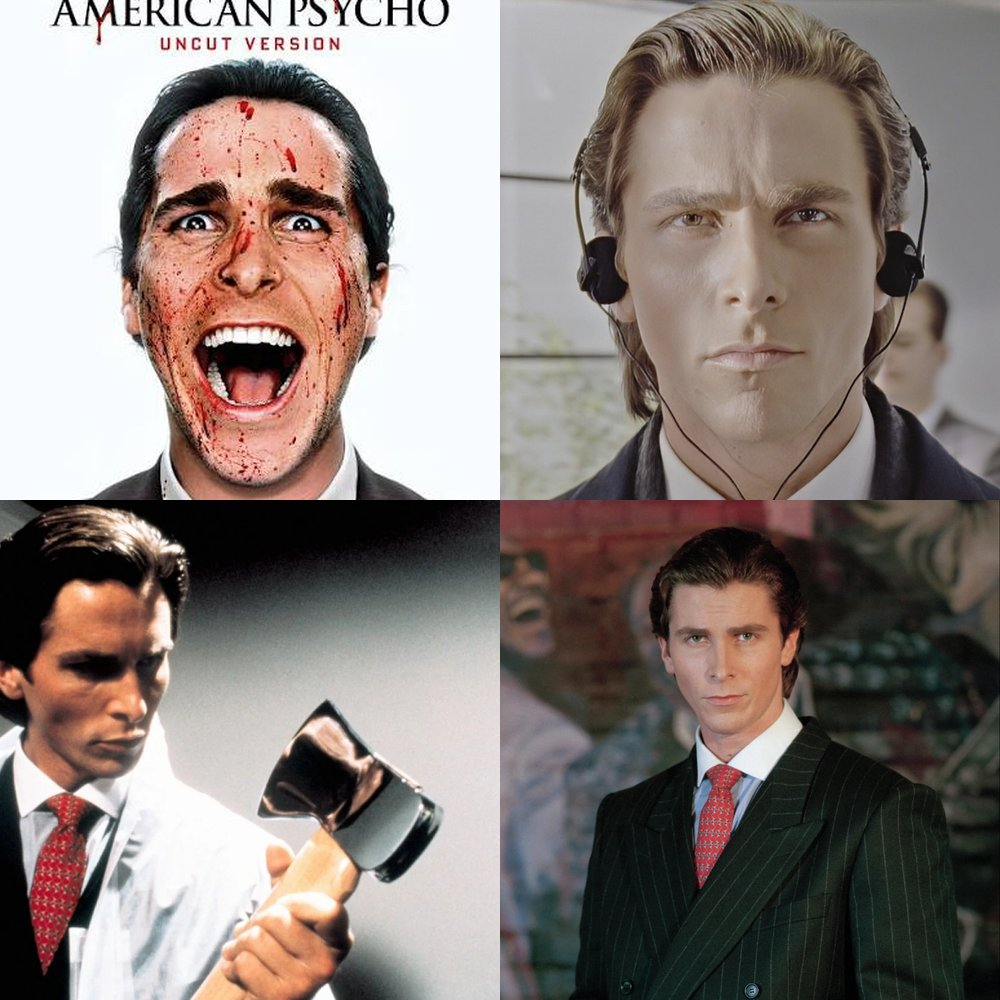
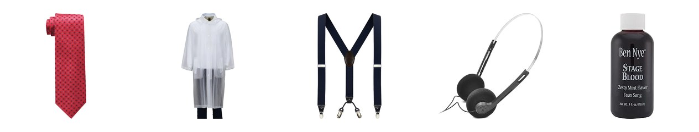
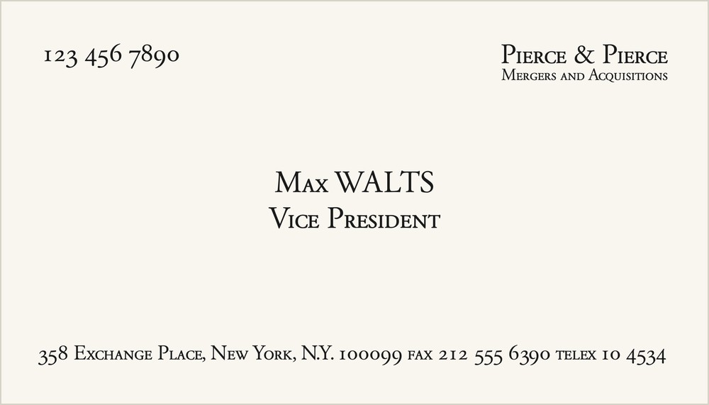
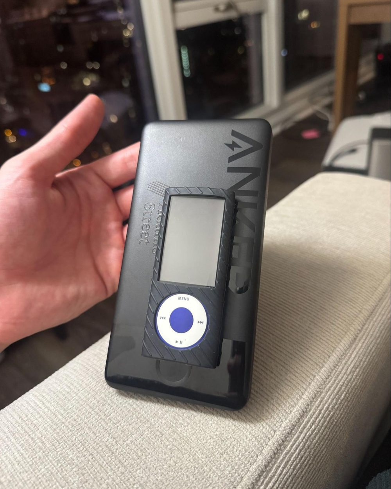
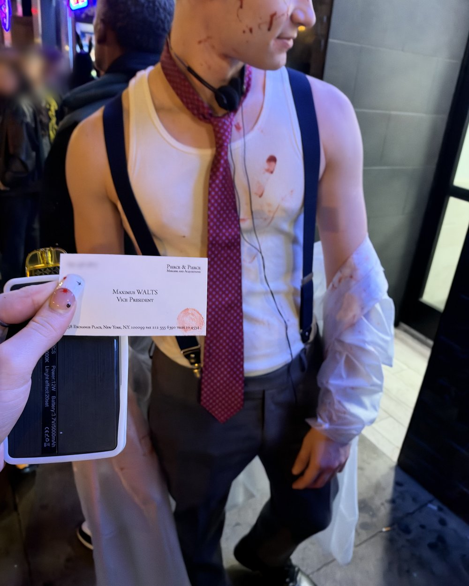

American Psycho is one of my favorite movies, and Patrick Bateman is a classic Halloween costume that always works. Here's everything I used to put mine together.

{: width="1000" height="1000"}

## What you need

- **The basics.** A white tank top, gray dress pants, and black dress shoes. I wore a tank instead of a dress shirt, because I like a Halloween costume to be a little sexy.
- **A retro patterned red tie.** I found [this one](https://www.amazon.com/dp/B00I1AEDJU).
- **A clear plastic raincoat.** [This one](https://www.amazon.com/dp/B000HHLVKY) is perfect. I got a bunch of comments on how it looks exactly like the one from the movie.
- **Suspenders.** Y-back is the style of the era, and Bateman wears blue suspenders with his red tie. I got [these](https://www.amazon.com/dp/B07SGHZXK4).
- **Headphones.** [Walkman-style headphones](https://www.amazon.com/dp/B0FNCYG5GQ) finish the look.
- **Business cards.** Bone colored, in the movie's "Silian Rail" lettering, to hand out at the party.
- **Stage blood,** for the raincoat and your face. I used [this one](https://www.amazon.com/dp/B002EV3JBU).

{: width="1264" height="240"}

## Making the business cards

"Silian Rail" isn't a real font. The lettering in the movie is Garamond Classico SC Regular, so I downloaded that and designed the cards in Canva. I put my phone number, Instagram, and website on mine.

{: width="1000" height="571"}

Then I printed them on cardstock at Staples and cut them out myself. Two sheets of cardstock made 20 cards for $5.

I also stamped each card with a thumbprint of blood in the corner, which was funny every time I handed one to someone.

You can [copy my design in Canva](https://canva.link/w2y5u8139l9l9r4) and swap in your own details.

## Stage blood

To be honest, it ended up looking more like I'd injured myself than anything. There's some skill involved in applying it well.

The good news is that it washes off super easily.

## A makeshift Walkman

For a Walkman, I taped an old iPod nano to a portable charger. Then I loaded it with all the music Bateman talks about in the movie: Whitney Houston, Genesis, Huey Lewis and the News, and so on.

Hearing that music in my headphones all night really helped me get into character.

{: width="1000" height="1250"}

## The final look

{: width="1000" height="1250"}

