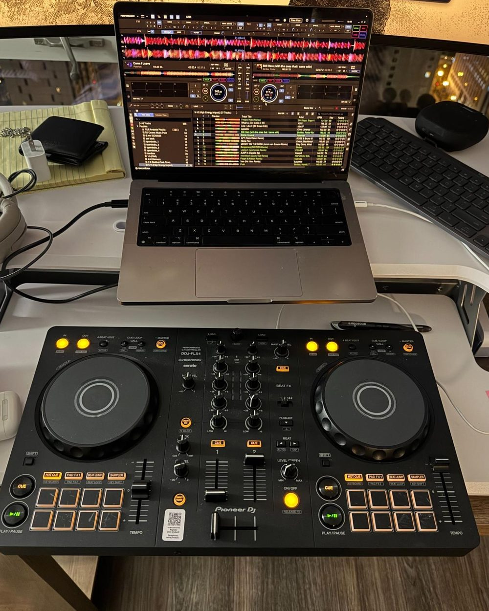
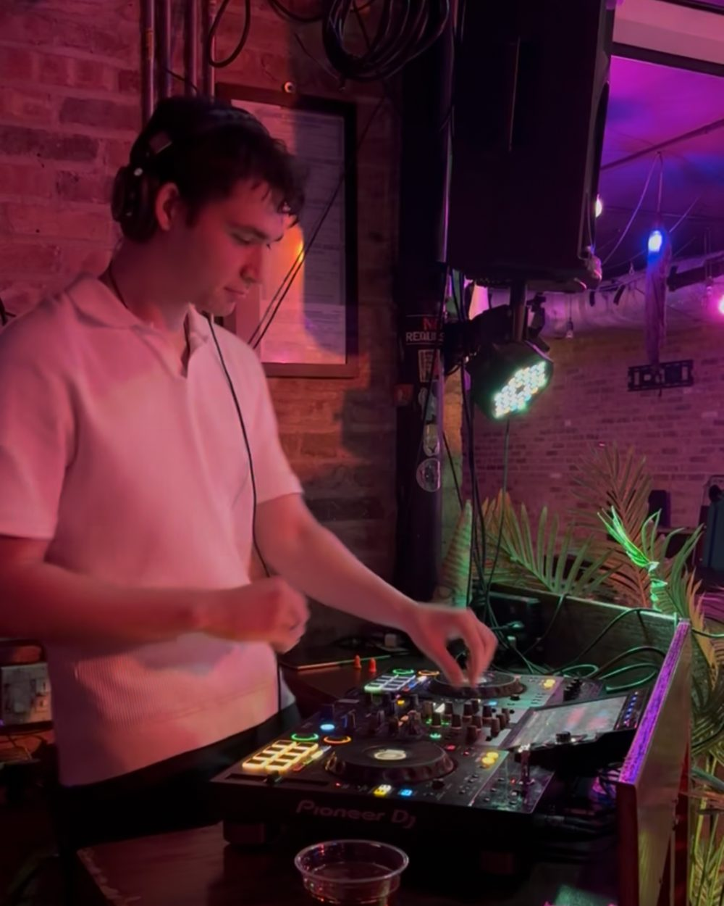
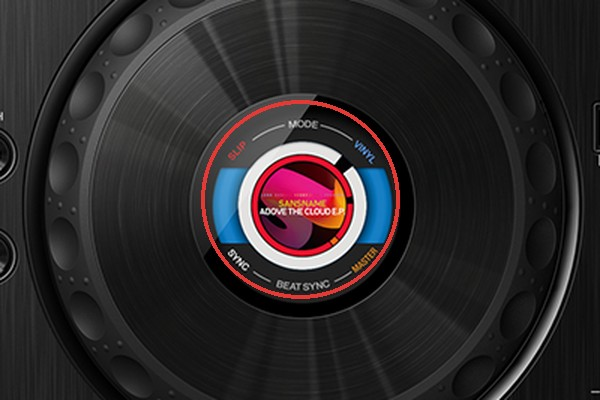
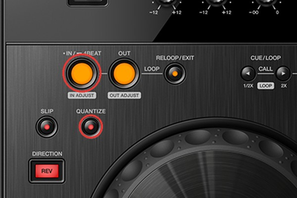
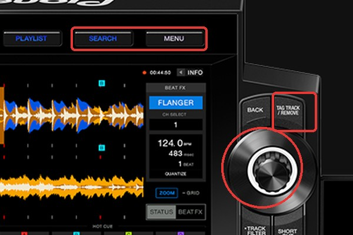
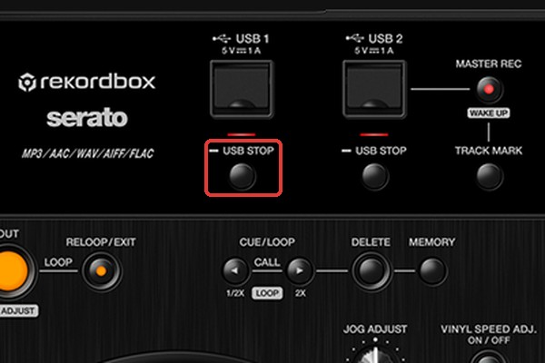
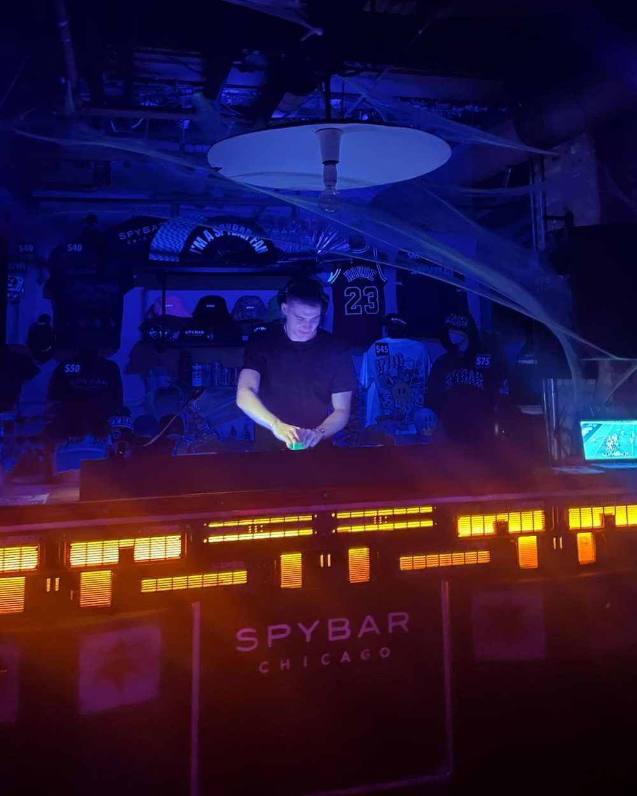
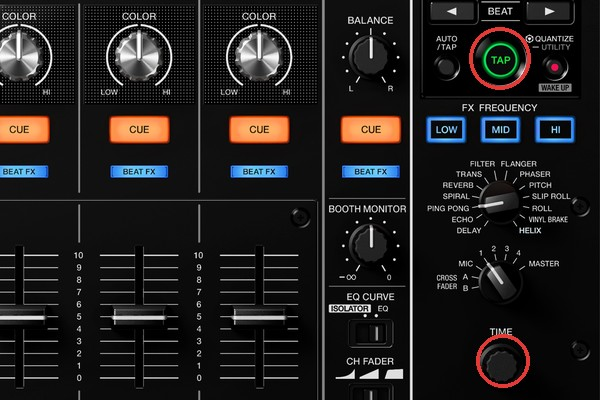
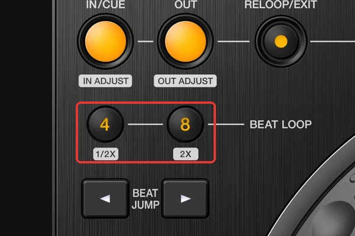

I started on the Pioneer DDJ-FLX4 with rekordbox, like a lot of beginner DJs. Since then, I've had to get used to two other kinds of setups: the all-in-one XDJ-RX3 that a lot of smaller bars have, and the CDJs and mixer you find at bigger clubs.

{: width="1000" height="1250"}

A few key things work differently, and some of the most useful features aren't ones you'll find just by tinkering during a set. So I did some research and put together my notes on the differences that matter most.

## The three setups

- **DDJ-FLX4 + rekordbox:** a controller plugged into your laptop. The music, the waveforms, and your library all live in rekordbox on the laptop.
- **XDJ-RX3:** an all-in-one unit, with two decks and a mixer in one body and a big touchscreen in the middle. It plays music straight from a USB stick, no laptop needed. This is what a lot of smaller bars have.
- **CDJs and a mixer:** two CDJ-3000 players with a separate mixer, like the DJM-900NXS2, between them, so three pieces of gear working together. This is the standard setup at bigger clubs.

## Pioneer XDJ-RX3

{: width="1000" height="1250"}

### Jog wheel screens

Each jog wheel has a small screen in the middle. It shows things like whether vinyl mode, sync, or master is turned on, so you can check a deck's state at a glance.

{: width="600" height="400"}

### Looping

- **Hold down IN to set a 4-beat loop.** The loop shows up on the jog wheel screen.
- **Turn on Quantize** so loops and beat jumps snap to the beat and land cleanly.

{: width="600" height="400"}

Notice the dot next to "IN" and the line next to "4BEAT." This works the same way across the deck: a dot means the action happens when you tap the button, and a line means it happens when you hold it.

### The touchscreen

The middle screen is a touchscreen, and it's where you browse your music. I didn't know it was a touchscreen at first, so I used the dial for everything. You can do that, but some things are much easier by touch.

Search and Menu are along the top, and the browse dial and Tag button are to the right:

{: width="600" height="400"}

- **Sort your tracks.** Tap Menu while browsing to sort by BPM or key.
- **Search by name.** Click the Search button to type in a track name.
- **Scroll faster.** While browsing, hold down the dial to jump by letter or by page.
- **Find tracks in a compatible key.** Tap Info in the top right of the touchscreen to see a track's key, then tap the key to see other tracks in the same or a related key, for in-key mixing.
- **Preview without loading.** When browsing tracks, hold your finger on a track's waveform to listen to it without loading it onto a deck.
- **Save tracks for later.** Click the Tag Track button, above the dial on the right, to add a track to the Tag List and "half pull" it when you know you'll want to play it soon.

### USB

The XDJ-RX3 can play music from a laptop or a USB stick. Export your playlists to the USB from rekordbox first (here's [how I organize my library](/blog/how-i-find-music-to-dj-with/#organizing-your-library)).

To record your set onto the USB, press the Master Rec button.

When you're ready to take the USB out, **hold the USB Stop button first.** That safely ejects it.

{: width="600" height="400"}

## CDJ-3000s and a DJM-900NXS2

{: width="1000" height="1250"}

### Linked waveforms

When the CDJs are connected with a link cable, each player shows both decks' waveforms stacked on top of each other. The waveform for the player you're standing at is the bigger one.

Don't count on it, though. The players won't always be linked, so get used to mixing without a stacked waveform to look at.

### Jog wheels

On a CDJ, slowly turning the jog wheel barely changes anything. To nudge a track into time, use quick, sharp nudges. It's a bit like vinyl: you have to move the platter faster than the track is playing.

### Mixer FX and BPM

The DJM-900NXS2 tries to detect the BPM on its own, so its beat effects run at the right speed. If it guesses wrong, hold Tap and twist the Time dial to set the BPM yourself. If the BPM display is flashing, the effects aren't synced to the track.

{: width="600" height="400"}

### Looping and performance features

- **On the player:** hot cues, In/Out loops, 4 and 8 beat loop buttons right under In and Out, and beat jump
- **On the screen:** beat loop and beat jump

{: width="600" height="400"}

## Why I stopped using the FLX4's pad effects

CDJs don't have the quick effect pads that the FLX4 has. I used to love the slip loop pad effect, but slip loops work completely differently on a CDJ.

So I stopped using the pad effects on the FLX4 too. If they're not part of how I mix, I won't miss them when I'm on CDJs. If you're practicing at home on a controller for gigs on club gear, it's worth practicing with only the features both have.

## Quick checklist before playing on new gear

- Export your playlists to a USB stick in rekordbox, and bring a backup stick.
- Don't depend on stacked waveforms.
- Check the mixer's BPM before using beat effects.
- Hold USB Stop before pulling out your stick.

---

I DJ as Max Control. Hear my mixes on [SoundCloud](https://soundcloud.com/maxcontrol), or see more on [my homepage](/#music).
