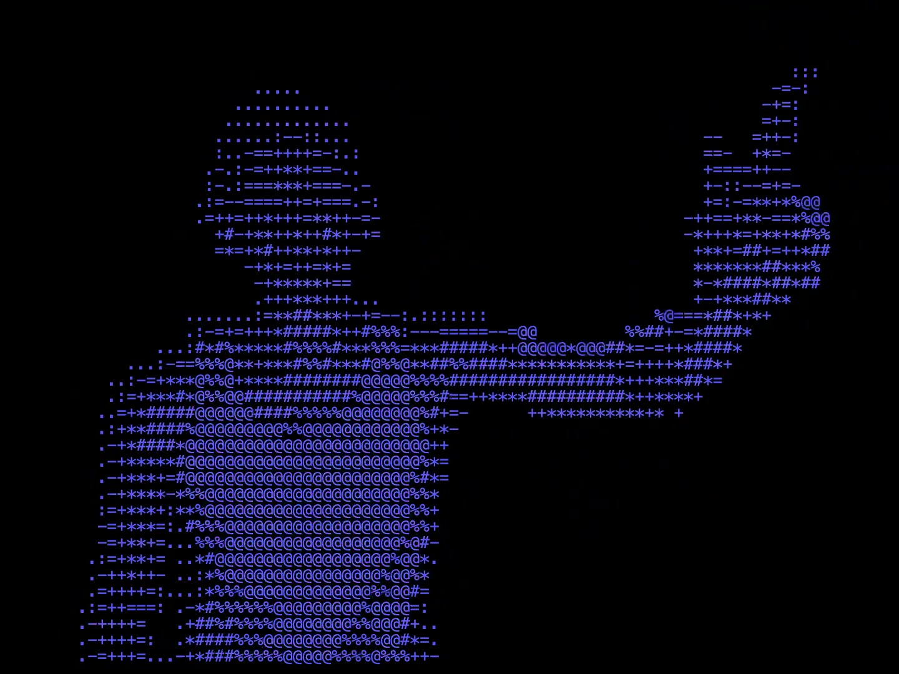
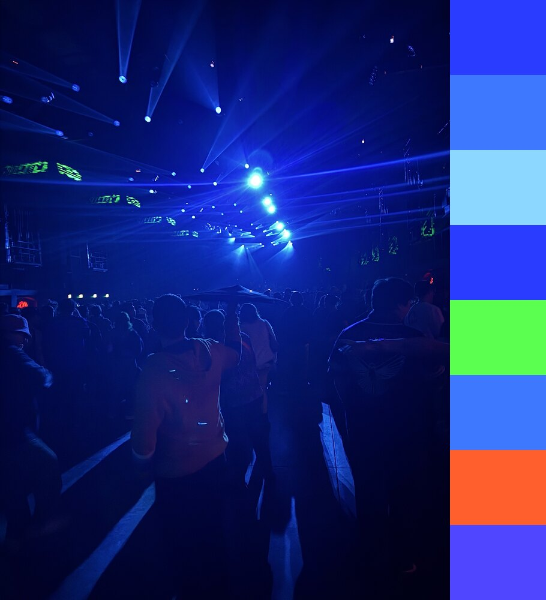
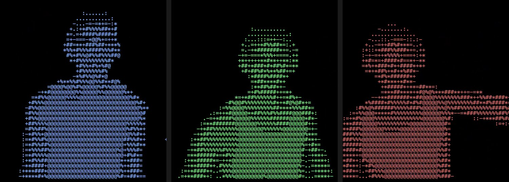

I wanted visuals for the sets I post on YouTube. I got the idea from [this reel](https://www.instagram.com/reel/DTTEYeKjP5b/) by 303.mtl, an audio-reactive ASCII camera made in TouchDesigner. I built my own version so I could get the video out quickly.

{: width="1440" height="1080"}

You can [try it in your browser](https://maxwalts.github.io/ascii-cam/) or get the code on [GitHub](https://github.com/maxwalts/ascii-cam).

## Webcam to ASCII

Each webcam frame is shrunk to a small grid, one pixel per character. Each pixel's brightness picks a character from a ramp, from a space for the darkest pixels to `@` for the brightest.

```js
const CHARS = " .:-=+*#%@"; // dark -> bright

const lum = (0.299 * r + 0.587 * g + 0.114 * b) / 255;
line += CHARS[Math.floor(lum * (CHARS.length - 1))];
```

Each frame's brightness range is stretched across the full ramp, so the image uses all the characters in any lighting.

## Cutting out the background

[MediaPipe's selfie segmentation](https://ai.google.dev/edge/mediapipe/solutions/vision/image_segmenter) finds the person in the frame. It's a small model from Google that runs in the browser, and it gives each pixel a score for how likely it is to be a person. Any cell below a cutoff is drawn as a space.

```js
segmenter.segmentForVideo(video, now, (result) => {
  mask = result.confidenceMasks[0].getAsFloat32Array();
});

// for each character cell
if (mask[i] < CUTOFF) line += " ";
```

- **Fast-moving hands** get blurry on a webcam, and the model scores them lower. To keep them, areas that are moving only need a low score.
- **Still areas** need a higher average score, so the background doesn't show up around the edges.

```js
const isMe =
  average >= CUTOFF ||
  (peak >= MOTION_CUTOFF && moving > MOTION_AMOUNT);
```

## Reacting to the music

You drag your mix file onto the page. The browser plays it and analyzes it at the same time. The mic isn't used.

It follows the kick drum. When the low end of the audio jumps above its recent average, that counts as a kick:

```js
if (bass > bassAvg * 1.25 && bass > 0.3) flash = 1;
flash *= 0.88; // fades out before the next kick
```

On each kick, the characters get brighter and the colors change faster.

<video src="/images/blog/ascii-cam-loop.webm" width="960" height="836" autoplay muted loop playsinline></video>

## Colors

The colors come from a photo I took at a rave: dark blue, bright blue, light cyan, laser green, and orange. The visualizer fades through them in order.

{: width="910" height="1000"}

```js
const PALETTE = [
  [42, 60, 255],   // dark blue
  [61, 120, 255],  // bright blue
  [140, 215, 255], // light cyan
  [90, 255, 80],   // laser green
  [255, 95, 45],   // orange
  // ...
];
```

{: width="1500" height="538"}

## Recording

The browser records the canvas directly, and the mix's audio is added to the same recording:

```js
const stream = canvas.captureStream(60);
mixAudio.getAudioTracks().forEach((t) => stream.addTrack(t));
const recorder = new MediaRecorder(stream, { videoBitsPerSecond: 16e6 });
```

- **R** starts and stops recording. The video downloads when you stop.
- **A** switches between 16:9, 9:16, and 1:1.
- **Q** switches between 1080p and 4K. YouTube gives 4K uploads a higher bitrate, so the characters stay sharper.

It records at 60fps. Recording happens in real time, so keep the tab open and visible the whole time.

## The result

Here's my set from Bourbon on Division in Chicago with the visualizer:

<iframe src="https://www.youtube-nocookie.com/embed/d-Z_tED9oJ0" title="Max Control — Live at Bourbon on Division (Nov 2026) [Visualizer]" allow="accelerometer; autoplay; clipboard-write; encrypted-media; gyroscope; picture-in-picture" allowfullscreen loading="lazy"></iframe>

All the settings, like the colors, character size, and how strongly it reacts, are at the top of the file.

---

I DJ as [Max Control](/maxcontrol/). Hear my mixes on [SoundCloud](https://soundcloud.com/maxcontrol).
